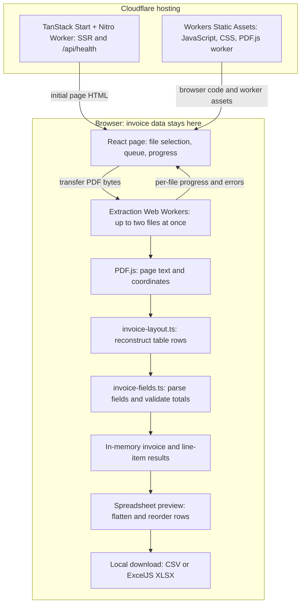

# invoice-extractor

A web app that turns Vietnamese PDF invoices into a spreadsheet of invoice
details and line items. Select one or more PDFs, review the extracted rows,
reorder them if needed, and download CSV or Excel (`.xlsx`). The interface is in
Vietnamese.

**Invoice processing happens entirely in the browser.** The app reads the PDF's
existing text and table coordinates using PDF.js and deterministic parsing rules.
There is no AI service, OCR, PDF upload endpoint, or database in this workflow.
Files and results stay in browser memory and are cleared on refresh.

## What the app does

1. Selecting PDFs starts extraction automatically. Each file shows its own page
   progress, result, or error; failed files can be retried independently.
2. The parser extracts invoice date, series, number, supplier, tax ID, subtotal,
   VAT, and payment total, plus item descriptions, units, quantities, prices,
   line totals, and available per-item VAT and after-tax amounts.
3. Validation flags missing fields, unsupported tables, unissued invoice numbers,
   and arithmetic differences for manual review. Results needing review remain
   available in the preview and export, with their issues attached.
4. **Xem Excel** opens a full-screen spreadsheet preview. Drag a row handle to
   reorder rows, or focus it and use Space, arrow keys, then Space again.
   Downloads follow the visible order. CSV is the default; XLSX is also available.

The parser supports specific Vietnamese invoice layouts rather than arbitrary
PDF tables. Each file is limited to **4 MiB and 100 pages**. Scanned invoices need
OCR, which is not implemented. Password-protected, damaged, or unreadable PDFs
produce a per-file error. Cell editing and dragging files onto the page are not
implemented; row reordering is supported.

## Core architecture

The app has two runtime boundaries: a browser that processes invoices and a
Cloudflare Worker that serves the web app and its health endpoint.



### Extraction and validation

`src/routes/index.tsx` owns the selected files, queue, progress, and results.
It starts at most two dedicated module Web Workers, queues the rest, and
transfers each PDF's `ArrayBuffer` to its worker. Each worker terminates after
its file finishes, and one file's failure does not stop the batch.

`src/workers/extract.worker.ts` reads pages with PDF.js and reports progress.
`src/lib/invoice-layout.ts` uses text positions and column headings to reconstruct
item tables. `src/lib/invoice-fields.ts` then recognizes Vietnamese field labels,
normalizes dates and numbers, and checks the extracted amounts with Decimal.js.
For combined documents, parsing prefers pages explicitly headed as VAT invoices
over payment requests, orders, or attachments.

The worker returns an `ExtractionResult`: one `Invoice` and its `LineItem[]`,
linked by invoice ID, with source filename and page references. The invoice has
an `extracted` or `needs_review` status and a list of issues. Arithmetic checks
use a tolerance of one đồng. A successful extraction means the configured
checks passed; users should still compare unfamiliar layouts with the source.

### Spreadsheet model

`src/lib/spreadsheet.ts` flattens results into one row per line item, repeating
invoice-level fields on each row. An invoice without parsed items still gets a
row so its fields and review issues are visible. **Do not sum the repeated invoice
subtotal, VAT, or payment-total columns across item rows**; use the line-level
amounts or group invoices first.

Invoice numbers and tax IDs stay strings to preserve leading zeros; quantities
and amounts are numeric, and unknown fields are blank. XLSX explicitly formats
identifiers as text; CSV consumers must import those columns as text to retain
leading zeros. Each row uses its item's VAT rate when available, including
mixed-rate invoices.

Printed discount amounts keep the sign shown on the PDF. The parser applies a
separate deduction internally when reconciling subtotal and VAT, so exported
discount values can be positive while reducing the invoice total.

`src/components/spreadsheet-preview.tsx` manages row ordering with dnd-kit and
passes that order to the exporter. CSV is generated directly; ExcelJS is loaded
on demand for XLSX. Both downloads are created locally from browser memory.

### Hosting and server boundary

TanStack Start provides file-based routes and server-rendered HTML, with React,
strict TypeScript, Tailwind CSS v4, and shadcn/ui for the interface. Nitro builds
the production `cloudflare_module` Worker; Wrangler serves its static assets.
`GET /api/health` is the only application API. PDF bytes and extracted fields are
not sent to the server, analytics, or storage by the app.

The retained Node parser and extraction-service adapter in `src/server/` support
the local CLI and tests. They use `pdf-parse` and share the layout and field
parsing modules with the browser. They are not used by web routes or included
in the Cloudflare Worker bundle. No Python runtime is required.

### Code map

| Location | Responsibility |
| --- | --- |
| `src/routes/index.tsx` | File selection, extraction queue, worker lifecycle, progress, and results |
| `src/workers/extract.worker.ts` | Browser PDF reading and parser-result mapping |
| `src/lib/invoice-layout.ts` | Table reconstruction from positioned text |
| `src/lib/invoice-fields.ts` | Field recognition, Vietnamese number parsing, and reconciliation |
| `src/types/invoice.ts`, `src/types/parser.ts` | UI/export data model and parser result contract |
| `src/components/spreadsheet-preview.tsx` | Read-only preview, row sorting, and download controls |
| `src/lib/spreadsheet.ts` | Row flattening, CSV generation, and XLSX export |
| `src/routes/api/health.ts` | Server health endpoint |
| `src/server/`, `scripts/parse-invoice.ts` | Local Node extraction and JSON CLI |
| `tests/` | Parser, generated-PDF, and spreadsheet regression tests |
| `vite.config.ts`, `wrangler.jsonc` | Development, production build, and Cloudflare runtime configuration |

## Local development

Node 24 is selected by `.nvmrc`. Use the installed Nub package manager locally;
the committed `pnpm-lock.yaml` is also suitable for pnpm in CI.

```sh
nub install --frozen-lockfile
nub run dev                 # http://127.0.0.1:3000, Vite hot reload
nub run typecheck
nub run lint
nub run test
nub run build
nub run cf:typegen          # regenerate Cloudflare runtime/binding types
nub run preview             # builds, then runs the real Workers runtime locally
```

`GET /api/health` returns `{"ok":true,"service":"invoice-extractor"}`. During
development Vite uses Nitro's local Node preset for fast reload; `preview` uses
Wrangler/workerd and the production `cloudflare_module` build. If port 3000 is
occupied, run `nub exec wrangler dev --config wrangler.jsonc --port 3001` after
`nub run build`.

## Cloudflare deployment

`wrangler.jsonc` points to Nitro's `.output/server/index.mjs` Worker and
`.output/public` static assets. The build output is generated; do not commit it.
There is one deployment adapter: Nitro's Cloudflare module preset. The
Cloudflare Vite plugin is intentionally absent.

```sh
nub run deploy:dry-run       # build and validate upload locally; no publication
nub exec wrangler login      # authenticate when ready to deploy
nub run deploy               # builds and publishes to Cloudflare Workers
```

For a pnpm-based CI environment, use `pnpm install --frozen-lockfile` and
`pnpm run deploy`. Publishing requires a Cloudflare account and may create a
`*.workers.dev` Worker. No cloud resources were created by this migration.

Cloudflare chooses the execution location based on its network; this configuration
does not guarantee a Singapore server or Singapore data residency. PDF parsing
and spreadsheet generation run on the user's device, outside Worker CPU usage.

## Local parser CLI

To inspect parser JSON without the web interface:

```sh
nub run parse:invoice /path/to/invoice.pdf
```

See [architecture notes](docs/architecture.md), [parser details](docs/parser.md),
[Cloudflare compatibility](docs/compatibility.md), and the dated
[verification record](docs/verification.md) for additional implementation and
validation context.
